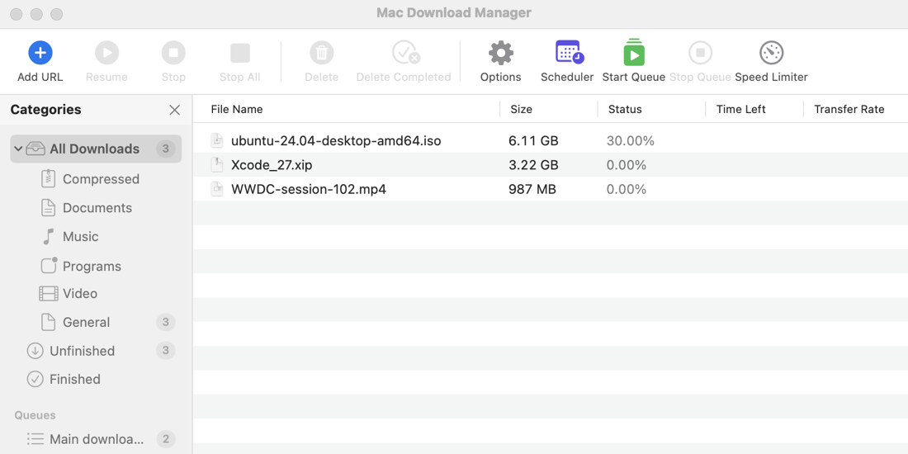
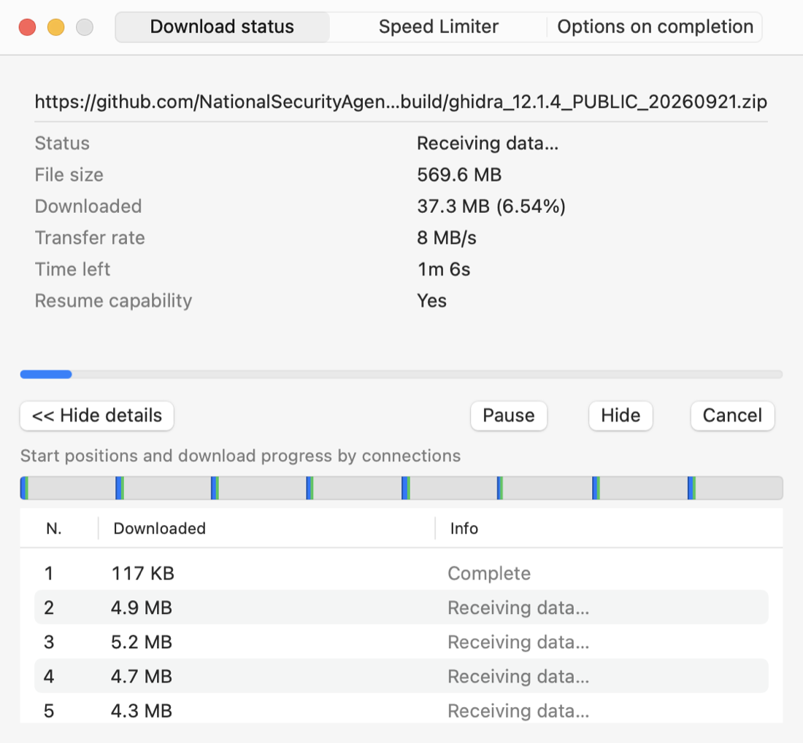
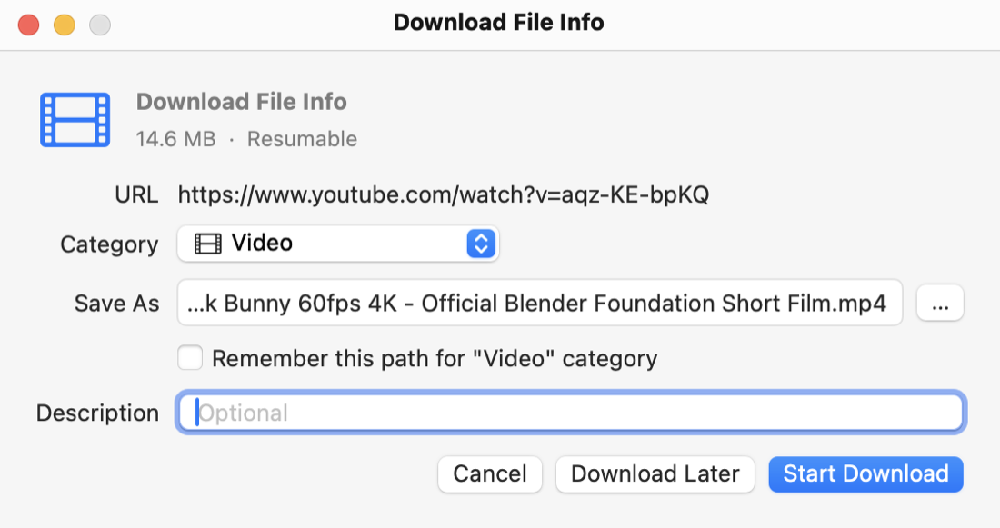
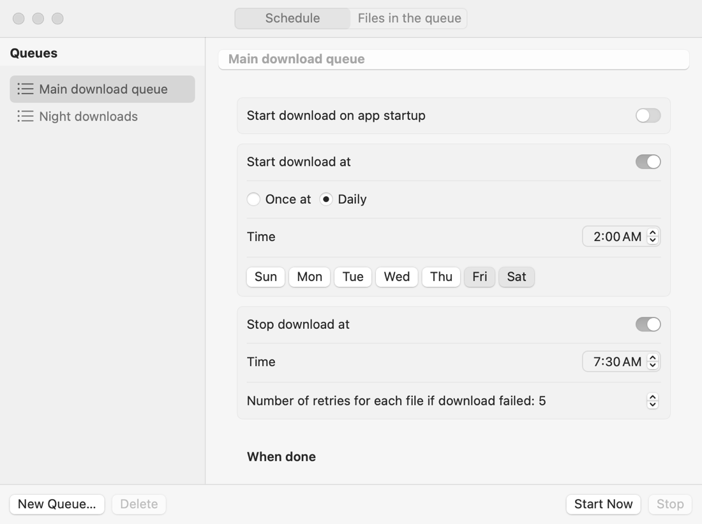
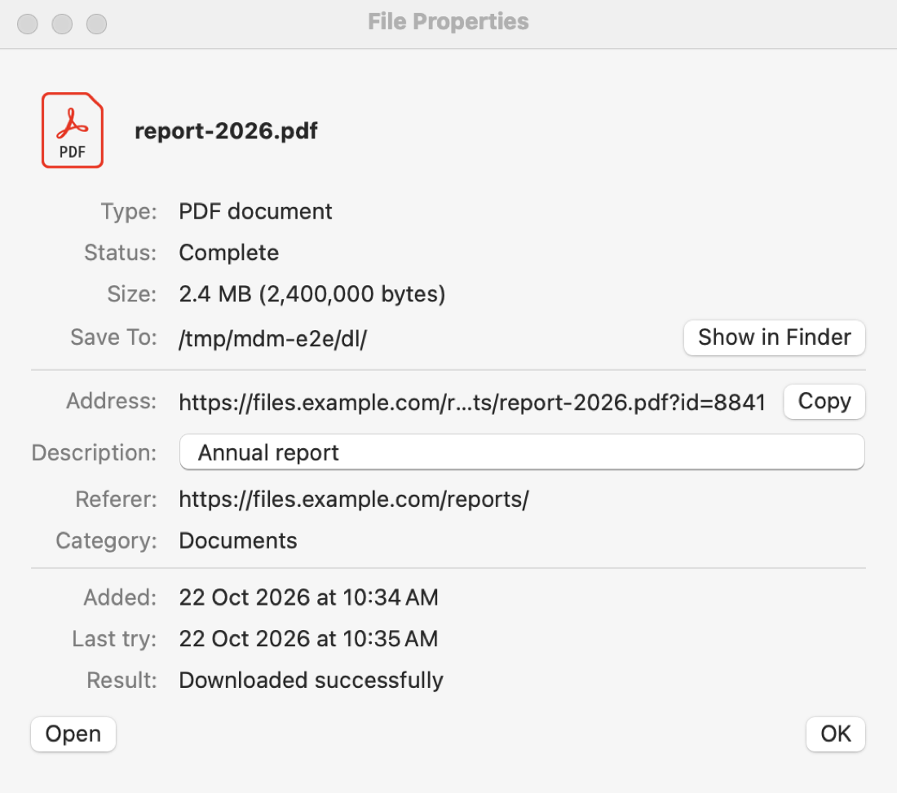

# Mac Download Manager

A native macOS download manager in Swift and SwiftUI, modeled on how Internet Download Manager (IDM) works: segmented multi-connection downloads that resume, browser capture, a "Download this video" button over web players (YouTube included, through yt-dlp), queues with a scheduler, and IDM's familiar windows.

> **بالعربي:** مدير تحميل للماك مكتوب بـ Swift و SwiftUI، مبني على طريقة شغل IDM: تقسيم الملف لأجزاء وتنزيلها بأكثر من اتصال مع إمكانية الاستكمال، والتقاط التحميلات من كروم، وزر "تحميل هذا الفيديو" فوق المشغّلات (بما فيها يوتيوب عن طريق yt-dlp)، والطوابير والجدولة، ونفس نوافذ IDM المعروفة. التفاصيل الكاملة بالإنجليزي تحت، ومواصفات كل جزء بالعربي في مجلد [`specs/`](specs/).



Not affiliated with, endorsed by, or containing any code or assets of IDM or Tonec Inc. See [How this was built](#how-this-was-built).

## Features

**Download engine** ([`Engine/`](Engine/))
- Splits a file into segments and downloads them in parallel over several connections, each on its own TCP connection (also for HTTP/2 servers, where URLSession would otherwise share one).
- Dynamic segmentation like IDM: a free connection takes over the second half of the largest remaining segment; the first split stays near the start of the file so media can be previewed early.
- Resumes after pausing, quitting, or a crash; progress is saved every second next to the partial file. Resuming also works when the link changes (video streams with expiring tokens).
- Retries failed connections with backoff, races a second connection against a stalled one, and checks 64 overlapping bytes between segments to catch a file that changed on the server.
- Global and per-download speed limits with real network back-pressure (the connection is paused, not just the writing).
- Falls back to a single stream for servers without range support.

**App** ([`App/`](App/))
- IDM's layout: a row of large buttons, a Categories tree (Compressed, Documents, Music, Programs, Video, General, Unfinished, Finished, Queues), and IDM's columns.
- Each category downloads into its own folder (`~/Downloads/Video`, …), as IDM does.
- "Download File Info" before a download starts, a "Download progress" window per download with a bar showing every connection's segment, "Download complete", and "File Properties" (double-click a finished download).
- Progress windows can be hidden while the download continues; a menu bar icon lists running downloads and brings their windows back ("Start view": normal, minimized, or not shown).
- Queues and Scheduler: files in order, *N* at the same time, start once or daily on chosen weekdays, stop at a time, retries per file, and when done: open a file, quit, sleep or shut down (with a 30-second countdown and Cancel).
- Dialogs appear over the browser, also in full screen, without switching Spaces.
- Closing the window keeps the app running in the menu bar; opening it again brings back the same copy.

**Updates, without a server**
- The app checks the project's GitHub releases (daily, or **Check for Updates…**), shows the release notes, and installs the new version in place: it pauses running downloads, swaps the app and relaunches, and the downloads continue.
- An update is installed only if it matches the SHA-256 GitHub publishes for it **and** carries the developer's Ed25519 signature, so a compromised GitHub account alone can't push an update.

**Browser integration** ([`App/BrowserExtension/`](App/BrowserExtension/))
- A Chrome extension (Manifest V3) that hands matching downloads to the app with the browser's cookies, referrer and user agent, so downloads that need a login work.
- "Download this video / audio" over players, with the available qualities (2160p … 144p, audio only) and their sizes.
- Talks to the app through Chrome Native Messaging and a local Unix socket that only your user account can open. If the app isn't reachable, the browser keeps the download.

**Video and audio**
- Uses [yt-dlp](https://github.com/yt-dlp/yt-dlp) to find streams and qualities on YouTube and many other sites, and [ffmpeg](https://ffmpeg.org) to join separate video and audio without re-encoding.
- Direct streams are downloaded by our engine (several connections, resumable); fragmented HLS/DASH streams are left to yt-dlp.
- The app installs yt-dlp from its official GitHub releases and checks it against the SHA-256 GitHub publishes.

| | |
|---|---|
|  |  |
|  |  |

## Download

Get **MacDownloadManager-0.1.2.dmg** from the [latest release](https://github.com/waleedafifi90/MacDownloadManager/releases/latest). It runs on Apple silicon and Intel Macs with macOS 15 or later.

1. Open the DMG and drag **MacDownloadManager** to **Applications**.
2. Open it once. macOS says it can't verify the developer, because the app isn't signed with an Apple Developer ID or notarized (that needs a paid Apple developer account).
3. Open **System Settings ▸ Privacy & Security**, scroll down and click **Open Anyway** next to "MacDownloadManager was blocked", then confirm.

Or, in Terminal: `xattr -dr com.apple.quarantine /Applications/MacDownloadManager.app`

The release page lists the DMG's SHA-256 so you can check your download: `shasum -a 256 MacDownloadManager-0.1.2.dmg`.

## Requirements

- macOS 15 or later (Apple silicon or Intel)
- Xcode 16 or later (Swift 6)
- For video sites: yt-dlp (installed from **Options ▸ Video**) and ffmpeg (`brew install ffmpeg`)
- For browser capture: Google Chrome or another Chromium browser (Edge, Brave, Chromium, Vivaldi, Arc)

## Build and run

```bash
git clone https://github.com/waleedafifi90/MacDownloadManager.git
cd MacDownloadManager/App
./make-app.sh
open build/MacDownloadManager.app
```

`make-app.sh` builds a release binary and wraps it in `build/MacDownloadManager.app` together with the native messaging host and the Chrome extension, then signs it ad hoc for local use. `./make-dmg.sh 0.1.2` builds a universal (Apple silicon + Intel) app and packs it into `build/MacDownloadManager-0.1.2.dmg` with its SHA-256.

The download engine also has a command-line tool:

```bash
cd Engine
swift run -c release mdm https://example.com/file.zip -o file.zip -n 8
```

## Connect Chrome

1. In the app, open **Options (⌘,) ▸ Browsers** and click **Connect Browsers**. This registers the native messaging host with every Chromium browser found and copies the extension to `~/Library/Application Support/MacDownloadManager/ChromeExtension`.
2. In Chrome, open `chrome://extensions`, turn on **Developer mode**, click **Load unpacked** and pick that folder (**Show Extension Folder** opens it).
3. Download a `.zip` or `.dmg`, or hover a video: the app takes it from there.

What gets captured (file types, excluded sites, minimum size) is set in **Options ▸ Browsers**. The toolbar button of the extension turns capture on and off.

## Releasing a new version

One-time setup on the maintainer's Mac: create the update signing key. The private key goes into the login Keychain (never into the repository); paste the printed public key into `UpdateSignature.publicKey` in `App/Sources/DownloadsCore/Updates/UpdateRelease.swift`.

```bash
cd App
swift run mdm-release keygen
swift run mdm-release export-private-key   # back this up somewhere safe: without it no update can ship
```

For each release:

```bash
echo 0.1.2 > App/VERSION
App/make-dmg.sh 0.1.2        # universal DMG + .sha256 + .sig (signed with the key)
git commit -am "Version 0.1.2" && git tag -a v0.1.2 -m "0.1.2" && git push origin main v0.1.2
gh release create v0.1.2 App/build/MacDownloadManager-0.1.2.dmg* --title "Mac Download Manager 0.1.2" --notes "..."
```

The DMG's `.sig` file must be attached to the release: installed copies refuse updates without a valid signature. Copies older than 0.1.2 have no updater and need one manual update.

## Project layout

```
Engine/                      Swift package: the download engine (no UI)
  Sources/DownloadEngine/    SegmentedDownload, SegmentPlanner, SpeedLimiter, ChunkStream
  Sources/mdm/               command-line downloader
  Sources/DownloadEngineTestSupport/  a local HTTP server with range support and faults
App/                         Swift package: the macOS app
  Sources/DownloadsCore/     download list, queues, scheduler, browser capture, yt-dlp (testable, no UI)
  Sources/CaptureProtocol/   messages and Unix socket shared by the app and the host
  Sources/mdm-native-host/   the program Chrome starts for the extension
  Sources/mdm-release/       signs release DMGs for the updater
  Sources/MacDownloadManager/ SwiftUI windows and panels
  BrowserExtension/chrome/   the Chrome extension
  make-app.sh                builds MacDownloadManager.app
specs/                       how IDM works and how each part is rebuilt here (Arabic)
research/tools, research/ghidra_scripts   our analysis scripts
docs/screenshots/
```

How the pieces talk to each other:

```
Chrome extension ──Native Messaging (stdio)──▶ mdm-native-host ──Unix socket──▶ app
                                                                   │
                                     DownloadManager ─▶ SegmentedDownload (several connections)
                                     QueueManager      MediaDownload ─▶ yt-dlp / ffmpeg
```

## Tests

```bash
cd Engine && swift test                     # engine: segmentation, resume, retries, speed limit, HTTP/2 …
cd App && swift test                        # app: list, queues, scheduler, capture, native host, yt-dlp parsing
node --test App/BrowserExtension/tests/rules.test.mjs App/BrowserExtension/tests/media.test.mjs
```

The engine and app tests run against a local HTTP server that can drop or stall connections. Tests that need the internet (installing yt-dlp, downloading a Creative Commons video from YouTube) run only with `MDM_NETWORK_TESTS=1`.

Development switches (environment variables, see `DevHooks.swift`): `MDM_DEV_STORE` and `MDM_SUPPORT_DIR` keep test runs out of your real download list, and `MDM_DEV_SNAPSHOT_DIR` saves images of the app's own windows.

## How this was built

The behavior was studied from IDM 6.43 build 15 (download segmentation, retries, browser capture, the layout of its windows) and written up in [`specs/`](specs/). The code here is written from scratch from those notes. IDM's own files (its programs, decompiled code, browser extension and texts) are not part of this repository, and none of its code, icons or images are used.

Downloading from YouTube is against YouTube's Terms of Service except where YouTube allows it; you are responsible for what you download. The app does not get around DRM.

## License

[MIT](LICENSE)
